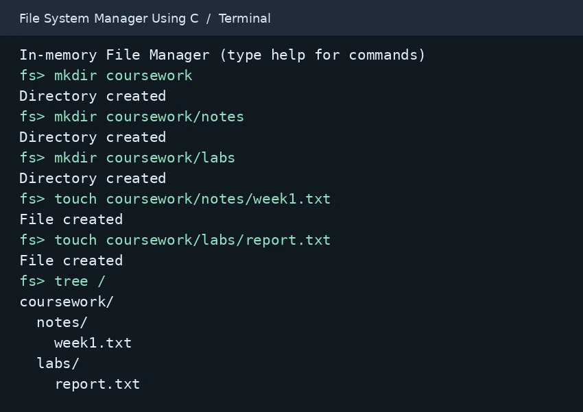
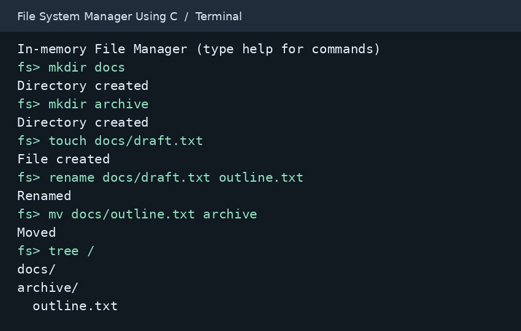
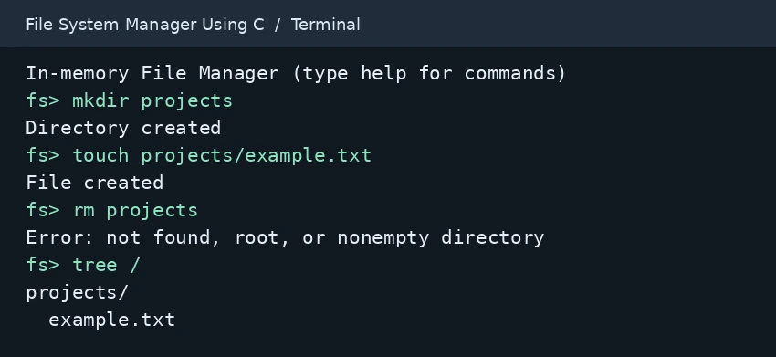

# File System Manager Using C


**A command-line, in-memory file system built in C to demonstrate how directories, file entries, trees, linked lists, and pointers work together.**

This CS 315 data structures project stores a virtual directory tree and file entries in memory. Changes disappear when you exit. The maintained CLI lives in `src/file_manager.c`.

## Screenshots

These terminal images use output from the compiled C program. The commands operate on a fresh in-memory file system with sample paths. [View all 5 screenshots](docs/screenshots/README.md).

| Build a folder hierarchy | Rename and move a file |
| --- | --- |
| [](docs/screenshots/folder-hierarchy.webp) | [](docs/screenshots/reorganizing-files.webp) |

| Reject deletion of a nonempty directory |  |
| --- | --- |
| [](docs/screenshots/protected-directory.webp) |  |

## Why this project exists

File systems provide a practical way to explore foundational data structures. Instead of only drawing a tree or writing a linked-list exercise, this project combines them into a small, interactive system. The goal is to practice dynamic memory allocation, pointer relationships, traversal, searching, and safe updates to a hierarchy.

## What you can do

- Create virtual directories and empty file entries.
- Navigate directories using absolute and relative paths.
- Display the directory tree.
- Rename and move entries.
- Remove files and empty directories.
- Reject duplicate names, invalid paths, and directory-move cycles.
- Build and run automated smoke tests with GitHub Actions.

## Quick start

Requires a C11 compiler such as GCC or Clang. Build from the repository root using the commands below. The [getting started guide](docs/Getting-Started.md) covers setup, and the [GitHub Actions workflow](.github/workflows/c-build.yml) shows the smoke tests.

```bash
git clone https://github.com/test3457890/File-System-Manager-Using-C.git
cd File-System-Manager-Using-C
cc -std=c11 -Wall -Wextra -pedantic -o file_manager src/file_manager.c
./file_manager
```

On Windows using MinGW, compile with `gcc -std=c11 -Wall -Wextra -pedantic -o file_manager.exe src/file_manager.c` and run `.\file_manager.exe`.

### Repeatable checks

Python 3 is needed for the CLI regression script. After compiling, run `python3 tests/cli.py ./file_manager` (on Windows, use `python tests/cli.py .\\file_manager.exe`). It checks exact output for navigation, moves, rejected operations, maximum name length, and recovery after an overlong command. GitHub Actions compiles with AddressSanitizer and UndefinedBehaviorSanitizer and runs these checks on Ubuntu; the program itself has no Python dependency.

### Example session

```text
fs> mkdir projects
Directory created
fs> cd projects
fs> touch notes.txt
File created
fs> pwd
/projects
fs> tree
notes.txt
fs> rename notes.txt ideas.txt
Renamed
fs> cd ..
fs> tree
projects/
  ideas.txt
fs> quit
```

## Commands

| Command | Purpose |
| --- | --- |
| `help` | Show command help |
| `pwd` | Print the current virtual path |
| `ls [path]` | Show a recursive listing (currently same traversal as `tree`) |
| `tree [path]` | Display entries under a directory |
| `cd <path>` | Change the current virtual directory |
| `mkdir <path>` | Create a directory |
| `touch <path>` | Create an empty virtual file entry |
| `rm <path>` | Remove a file or empty directory |
| `rename <path> <name>` | Rename an entry |
| `mv <path> <directory>` | Move an entry into a directory |
| `quit` | Exit |

Names must be 1–63 characters long and cannot contain spaces or slashes. Paths can begin at the root (`/projects`) or current directory (`../projects`).

## How it works

Each virtual file or directory is represented by a `Node`. The node stores its name, whether it is a directory, a parent pointer, a pointer to its first child, and a pointer to its next sibling.

```text
/
└── projects/           (child of root)
    ├── notes.txt       (first child)
    └── images/         (next sibling)
        └── logo.png
```

This is a **tree represented using linked lists**: `children` goes down one level, `next` moves across siblings, and `parent` moves up. The program searches directories by name, updates pointers when entries move or are removed, and frees allocated nodes before exiting.

Read more in the [documentation](docs/README.md).

## Repository layout

```text
src/file_manager.c                  Current standalone C11 implementation
.github/workflows/c-build.yml       Build and smoke tests
docs/                                Project documentation and wiki-style guides
IMPROVED_VERSION.md                  Earlier improvement notes
File System Manager Using C/         Original CS315 project materials
```

The original coursework files remain available for historical reference. The original code references a missing `fs_lite.h`; use `src/file_manager.c` for the working version.

## Current limitations

- Data exists only while the program is running; there is **no save/load feature**.
- Virtual files do not store contents or interact with the host file system.
- The CLI uses whitespace-separated arguments, so names with spaces are unsupported.
- `ls` currently displays a recursive listing rather than only immediate children.
- Deleting a directory with children is intentionally blocked.

See the [roadmap](docs/Roadmap.md) for potential future improvements. These items are **plans, not completed features**.

## Documentation

Start with the [GitHub Wiki](https://github.com/test3457890/File-System-Manager-Using-C/wiki) for a guide to the project docs.

- [Documentation home](docs/README.md)
- [Getting started](docs/Getting-Started.md)
- [Architecture and data structures](docs/Architecture.md)
- [Commands and examples](docs/Commands.md)
- [Roadmap](docs/Roadmap.md)

## About the project

This repository documents the design and evolution of a C data-structures learning project. It is intended for students, developers learning pointers and linked lists, and anyone curious about the internals of a simplified file-system hierarchy.

**Maintainer:** [test3457890](https://github.com/test3457890)

Contributions and suggestions can be discussed through GitHub Issues. No license is currently specified; please do not assume permission to redistribute or reuse the code beyond applicable law.
