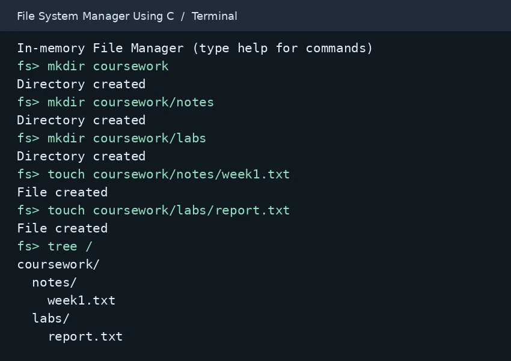
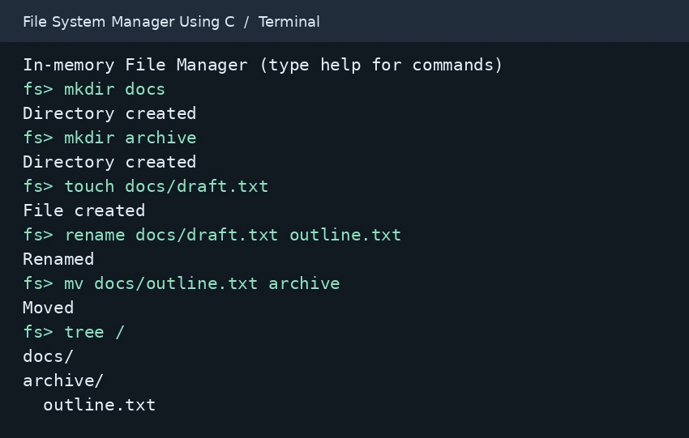
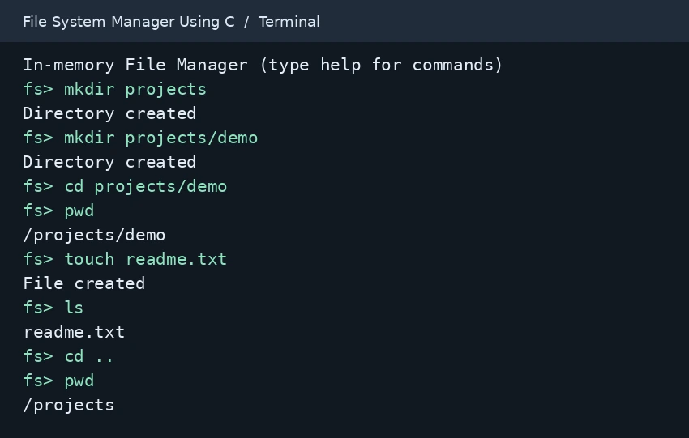
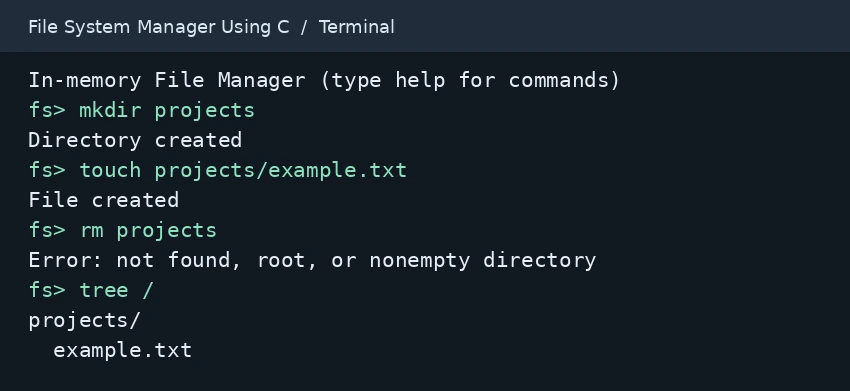
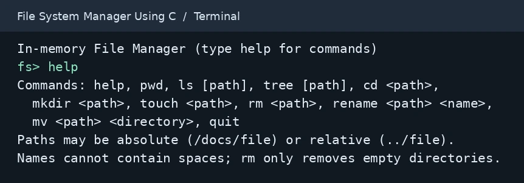

# File System Manager Using C screenshots

These terminal images use output from the compiled C program. The commands operate on a fresh in-memory file system with sample paths.

Select an image to open it at full size.

| Build a folder hierarchy | Rename and move a file |
| --- | --- |
|  |  |

| Navigate directories and inspect the current path | Reject deletion of a nonempty directory |
| --- | --- |
|  |  |

| Command reference at the terminal |  |
| --- | --- |
|  |  |
